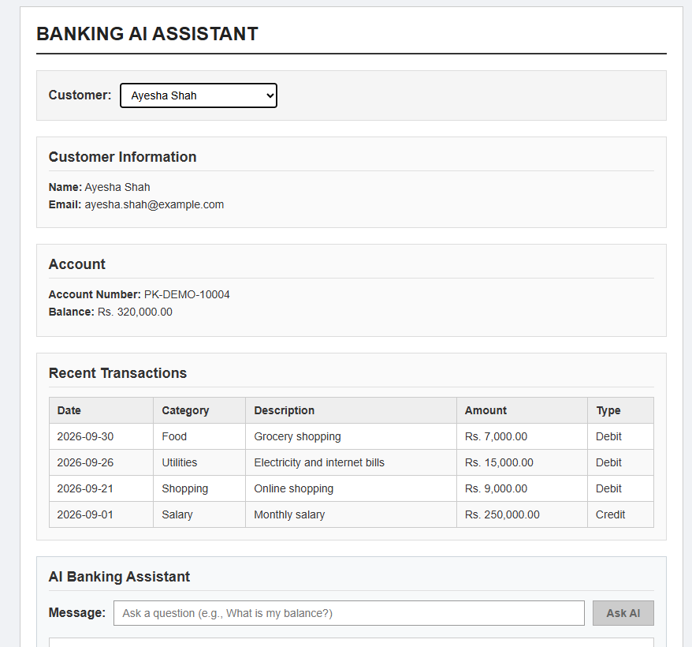
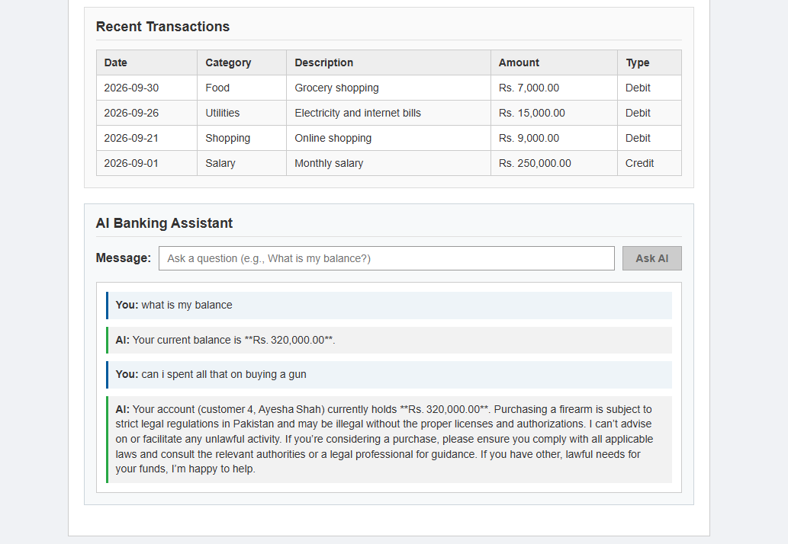

# Banking AI Assistant — Full-Stack Application

<!-- DASHBOARD SCREENSHOT PLACEHOLDER -->
<!-- Replace the link below with your screenshot path or URL (e.g. ) -->
<div align="center">

### 📸 Application Dashboard Screenshot


</div>

---

## 📌 Project Overview
A simple, beginner-friendly banking assistant system with:
- **Backend**: ASP.NET Core Web API with Entity Framework Core, SQL Server, and OpenRouter AI (`nvidia/nemotron-3-super-120b-a12b:free`)
- **Frontend**: Clean, lightweight Angular 20 single-page application connecting directly to the backend REST API

---

## 🔑 How to Set the AI / OpenRouter API Key

The backend uses **.NET User Secrets** so the API key is never committed to source code or git.

### Step 1: Navigate to the Backend Folder
Open your terminal / command prompt and run:
```bash
cd BankingAgent.Api
```

### Step 2: Set the Key via .NET User Secrets
Run the following command replacing `YOUR_OPENROUTER_API_KEY_HERE` with your actual key from [OpenRouter](https://openrouter.ai/keys):
```bash
dotnet user-secrets set "OpenRouter:ApiKey" "YOUR_OPENROUTER_API_KEY_HERE"
```

### (Alternative) Set via Environment Variable
If you prefer environment variables:
- **Windows (PowerShell)**:
  ```powershell
  $env:OpenRouter__ApiKey="YOUR_OPENROUTER_API_KEY_HERE"
  ```
- **Windows (CMD)**:
  ```cmd
  set OpenRouter__ApiKey=YOUR_OPENROUTER_API_KEY_HERE
  ```
- **Linux / macOS (Bash)**:
  ```bash
  export OpenRouter__ApiKey="YOUR_OPENROUTER_API_KEY_HERE"
  ```

---

## 🚀 How to Run Both Projects

To run the complete system, run the **Backend** and **Frontend** in two separate terminal windows.

### 1. Run the ASP.NET Core Backend

1. Open a terminal and navigate to `BankingAgent.Api`:
   ```bash
   cd BankingAgent.Api
   ```

2. (First-time setup only) Ensure your SQL Server database is created and migrations are applied:
   ```bash
   dotnet ef database update
   ```

3. Start the backend:
   ```bash
   dotnet run
   ```

4. The backend API is now running at:
   - **Base URL**: `http://localhost:5146`
   - **Scalar API Documentation UI**: `http://localhost:5146/scalar/v1`

---

### 2. Run the Angular Frontend

1. Open a second terminal window and navigate to `banking-ui`:
   ```bash
   cd banking-ui
   ```

2. (First-time setup only) Install dependencies:
   ```bash
   npm install
   ```

3. Start the Angular development server:
   ```bash
   npm start
   ```
   *(or `ng serve`)*

4. Open your browser and visit:
   - **Angular UI**: `http://localhost:4200`

---

## 📂 Project Architecture

```text
agentapi/
├── README.md                  # Main setup & running instructions
├── ANGULAR_EXPLANATION.md     # Detailed beginner-friendly Angular architecture guide
├── BankingAgent.Api/          # ASP.NET Core Web API backend (Port 5146)
│   ├── Controllers/           # REST endpoints (Customers, Accounts, Transactions, Agent)
│   ├── Services/              # AgentService and OpenRouterService
│   ├── Data/                  # EF Core AppDbContext and Seed Data
│   └── Program.cs             # DI configuration, Middleware, CORS policy
└── banking-ui/                # Angular 20 frontend (Port 4200)
    ├── src/
    │   ├── environments/      # Backend API URL configuration (environment.ts)
    │   └── app/
    │       ├── models.ts      # TypeScript interfaces (Customer, Account, Transaction)
    │       ├── services/      # HttpClient services for backend communication
    │       └── components/    # Dashboard component (view & chat logic)
    └── package.json
```

---

## 🧪 Testing the Application

1. **Customer Selection**: Use the dropdown at the top to select any customer (e.g., *Ali Khan*, *Sara Ahmed*).
2. **Account & Transactions**: Observe the account number, balance, and recent transaction history update automatically.
3. **AI Banking Chat**: Type questions into the message box such as:
   - *"What is my balance?"*
   - *"How much did I spend on food?"*
   - *"Show me my recent transactions"*
4. The AI will retrieve the customer's real banking data using tool calling and reply naturally.
